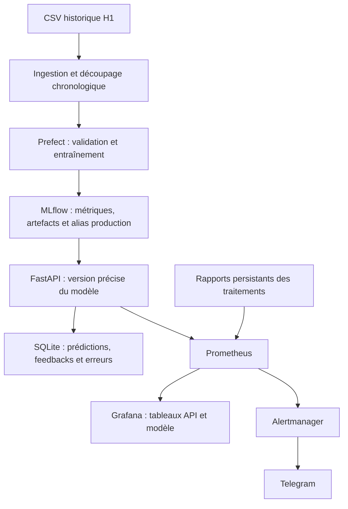

# Prédiction des annulations hôtelières — projet MLOps

Ce projet prédit l'annulation d'une réservation hôtelière et démontre localement l'ingestion, les contrôles de qualité, l'entraînement, la gestion des versions, la prédiction, les retours utilisateurs, l'orchestration et la supervision. Le modèle est volontairement simple : l'objectif du projet porte sur la chaîne opérationnelle.

## Organisation du dépôt

| Emplacement | Rôle |
|---|---|
| `src/hotel_mlops/` | API, entraînement, préparation, validation, persistance et métriques |
| `src/hotel_mlops/orchestration/` | Flux Prefect et déploiement hebdomadaire |
| `src/hotel_mlops/experiments/` | Comparaison et réglage facultatifs des modèles |
| `config/` | Paramètres du modèle, limites de ressources, Prometheus, Alertmanager et Grafana |
| `docker/` | Images Docker de l'API et de MLflow |
| `requirements/` | Dépendances de l'API, du développement et de MLflow |
| `data/raw/H1.csv` | Source H1 locale, exclue de Git |
| `data/prepared/` | Fichiers d'entraînement et de test, exclus de Git |
| `artifacts/` | Modèles locaux, exclus de Git |
| `reports/evaluation/` | Petits rapports d'évaluation conservés dans le dépôt |
| `reports/load/` | Rapports détaillés des tests de charge, conservés localement |
| `docs/` | Synthèse OPS, présentation et éléments de démonstration |
| `tests/` | Tests automatisés et scénario Locust dans `tests/load/` |
| `scripts/` | Retour arrière, incident contrôlé et mesure de charge |
| `manage.py` | Point d'entrée des commandes du projet |
| `compose.yaml` | Services Docker locaux |

Les commandes historiques `python train.py` et `python orchestration/training_flow.py` ont été remplacées par `python manage.py ...`. Les volumes Docker conservent les données locales lors du redémarrage des conteneurs.

## Données et modèle

Source : N. Antonio, A. de Almeida et L. Nunes, « Hotel booking demand datasets », *Data in Brief* 22 (2019), p. 41-49, https://doi.org/10.1016/j.dib.2018.11.126. Télécharger le CSV H1 (hôtel resort) dans les données complémentaires de l'article et conserver l'attribution prévue par la licence CC BY 4.0. H2 n'est pas utilisé.

Les fichiers préparés existants comportent **31 986 lignes d'entraînement**, **8 074 lignes de test** et **23 variables explicatives**. La cible `IsCanceled` vaut 0 si la réservation est maintenue et 1 si elle est annulée. Les CSV volumineux et les modèles binaires sont exclus de Git. Le rejeu de ces données historiques simule une arrivée de données ; ce projet ne se connecte pas à un flux hôtelier en direct. Une nouvelle ingestion peut produire un découpage chronologique différent des fichiers préparés antérieurs.

Le modèle de référence est un arbre de décision, conservé pour son rappel et son F1 sur le jeu de test : précision **0,629**, rappel **0,898**, F1 **0,740**, exactitude **0,776**. L'arbre réglé obtient respectivement 0,720 / 0,526 / 0,608 / 0,759 ; la forêt aléatoire, 0,744 / 0,649 / 0,694 / 0,796. Ces résultats sont indicatifs : la complexité et le score du modèle ne sont pas l'objectif de l'évaluation.

## Architecture



Python 3.11, pandas et scikit-learn assurent la préparation et l'entraînement. Prefect 3.9.3 planifie et suit les traitements ; MLflow 3.18.0 suit les expériences et les versions enregistrées. FastAPI/Uvicorn servent les prédictions ; SQLite conserve les traces. Prometheus et Grafana supervisent le service et les résultats collectés. Prefect envoie les échecs du flux à Telegram ; Alertmanager transmet les alertes de disponibilité de l'API. Docker Compose lance l'API, MLflow, Prometheus, Alertmanager et Grafana ; Prefect fonctionne sur l'hôte.

## Installation

Ouvrir PowerShell dans le dossier du projet. Créer un environnement Python 3.11 isolé :

```powershell
python -m venv .venv
.\.venv\Scripts\Activate.ps1
python -m pip install -r requirements/development.txt
python -m pip check
python -m pytest -q
```

Les 24 tests ont réussi dans l'environnement du projet. L'installation dans un environnement neuf reste à vérifier. Les dépendances directes sont fixées dans `requirements/`. Prefect impose notamment `FastAPI >=0.139,<0.151` ; éviter de mettre FastAPI à jour séparément. Après une installation propre, enregistrer les versions effectivement résolues :

```powershell
python -m pip freeze | Set-Content -Encoding utf8 requirements/lock.txt
```

Le verrouillage complet n'a pas encore été généré. Les paramètres métier sont dans `config/project.toml`. Les chemins et adresses du service sont configurables avec `MLFLOW_TRACKING_URI`, `PREFECT_API_URL`, `PREDICTIONS_DB_PATH` et `REPORTS_DIR`.

## Démarrage des services

Lancer Docker Desktop. Pour activer les notifications, copier le jeton du bot depuis BotFather, puis exécuter dans le terminal PowerShell destiné aux commandes Prefect :

```powershell
$botToken = (Get-Clipboard -Raw).Trim()
New-Item -ItemType Directory -Force secrets | Out-Null
[System.IO.File]::WriteAllText((Join-Path $PWD 'secrets\telegram_bot_token'), $botToken, [System.Text.UTF8Encoding]::new($false))
$env:TELEGRAM_BOT_TOKEN = $botToken
$env:TELEGRAM_CHAT_ID = '6965052159'
```

Le dossier `secrets/` est exclu de Git. Alertmanager lit ce fichier local. Les variables d'environnement doivent être redéfinies dans un nouveau terminal utilisé pour `flow` ou `serve`. Pour un autre destinataire, remplacer l'identifiant du chat dans la commande et dans `config/alertmanager/alertmanager.yml`.

```powershell
docker compose up --build -d
docker compose ps
```

Avec un volume MLflow vide, démarrer d'abord MLflow (`docker compose up --build -d mlflow`), effectuer un premier entraînement pour créer l'alias `production`, puis démarrer l'API. Sur l'installation actuelle, la dernière version vérifiée de l'API est **v8**. Si les dossiers de configuration de Prometheus et Grafana ont changé, redémarrer ces services avec `docker compose restart prometheus grafana`.

| Service | Adresse locale |
|---|---|
| Documentation API | http://127.0.0.1:8000/docs |
| Santé API | http://127.0.0.1:8000/health |
| Métriques API | http://127.0.0.1:8000/metrics |
| Qualité selon les feedbacks | http://127.0.0.1:8000/ops/model-quality |
| Historique des incidents | http://127.0.0.1:8000/ops/alerts |
| MLflow | http://127.0.0.1:5000 |
| Alertes Prometheus | http://127.0.0.1:9090/alerts |
| Alertmanager | http://127.0.0.1:9093 |
| Tableau Grafana API | http://127.0.0.1:3000/d/cancellation-api |
| Tableau Grafana modèle | http://127.0.0.1:3000/d/hotel-model-operations |
| Prefect | http://127.0.0.1:4200 |

Les volumes Docker nommés conservent la base SQLite de l'API, les métadonnées et modèles MLflow, les données de Prometheus/Alertmanager et l'état de Grafana.

## Ingestion, entraînement et orchestration

```powershell
python manage.py --help
python manage.py train
```

Par défaut, l'entraînement utilise `data/prepared/train.csv` et `data/prepared/test.csv`. Il écrit `reports/evaluation/metrics.json` et enregistre un candidat dans MLflow. La promotion n'a lieu que si le rappel arrondi est au moins **0,898** et le F1 au moins **0,740** ; un candidat rejeté ne change pas l'alias de production. Ces seuils illustrent une politique de mise en service, sans objectif de score imposé par le projet.

Pour reproduire l'ingestion dans un nouveau dossier sans écraser les fichiers existants :

```powershell
python manage.py ingest --source data/raw/H1.csv --output-dir data/prepared-v2
python manage.py train --train data/prepared-v2/train.csv --test data/prepared-v2/test.csv
```

L'ingestion contrôle les valeurs et la cible avant préparation, conserve les dates d'arrivée entières de chaque côté de la séparation 80/20 et écrit un manifeste avec provenance et empreintes SHA-256 de la source et des sorties. Cette exécution sur H1 reste à vérifier ; ses effectifs et métriques pourront différer des fichiers préparés historiques.

Pour suivre les flux dans Prefect, lancer `prefect server start` dans un autre terminal, puis :

```powershell
$env:PREFECT_API_URL = 'http://127.0.0.1:4200/api'
python manage.py flow
```

Pour servir le déploiement hebdomadaire, conserver un autre terminal actif :

```powershell
$env:PREFECT_API_URL = 'http://127.0.0.1:4200/api'
python manage.py serve
```

Le serveur Prefect et le processus `serve` doivent rester en marche pour les exécutions planifiées. Le calendrier réutilise les fichiers historiques. Pour inclure l'ingestion lors d'un déclenchement, renseigner `source_path` avec le chemin absolu du CSV brut dans les paramètres du flux ; les sorties sont écrites dans un dossier unique sous `data/`. La validation bloque l'entraînement si le schéma, les classes, les plages de valeurs ou les fichiers sont invalides. Les rapports d'exécution et les sorties du sous-processus sont enregistrés sous `reports/`.

L'API résout l'alias au démarrage puis charge la version exacte. Après une promotion :

```powershell
docker compose up -d --force-recreate cancellation-api
Invoke-RestMethod http://127.0.0.1:8000/health
```

Des commandes complémentaires permettent les prédictions en lot et la comparaison historique :

```powershell
python manage.py predict --input data/prepared/test.csv --output reports/predictions.csv
python manage.py compare
python manage.py tune
python manage.py evaluate
```

La prédiction en lot utilise l'artefact local ; l'API utilise l'alias MLflow. Les expériences comparatives ne font pas partie du flux de production planifié.

## Prédictions et feedbacks

```powershell
$prediction = Invoke-RestMethod -Method Post -Uri 'http://127.0.0.1:8000/predict' -ContentType 'application/json' -Body '{"LeadTime":100}'
$prediction
Invoke-RestMethod -Method Post -Uri 'http://127.0.0.1:8000/feedback' -ContentType 'application/json' -Body ('{{"prediction_id":"{0}","actual_canceled":1}}' -f $prediction.prediction_id)
```

Ne transmettre comme feedback réel qu'un résultat effectivement observé ; indiquer explicitement les résultats simulés. Chaque prédiction conserve ses entrées, son résultat, sa probabilité, son horodatage, sa durée et la version du modèle. Un identifiant n'accepte qu'un retour : doublon → 409, identifiant inconnu → 404. Les champs typés rejettent les clés inconnues, types/plages invalides, dates invalides et requêtes vides avec le code 422. Les requêtes partielles restent possibles grâce à l'imputation du pipeline ; utiliser des variables complètes pour évaluer un cas réaliste.

Les réponses incluent `X-Request-ID`. Les erreurs HTTP sont enregistrées dans SQLite ; les erreurs internes renvoient un message générique 500. Si la base est indisponible, des journaux détaillés restent dans le conteneur. `duration_ms` mesure le calcul de prédiction, sans l'accès à la base ni le réseau ; Locust mesure le temps de réponse complet.

## Supervision et incidents

Grafana provisionne deux tableaux depuis `config/grafana/`. Le premier présente le débit par route, la latence p95, les erreurs 5xx et la disponibilité des métriques. Le second présente le nombre de feedbacks par version, les scores calculables, le dernier statut d'entraînement, sa durée, le nombre d'échecs et les alertes. Les scores issus des retours couvrent les 30 derniers jours et restent absents avant **30 retours** et la présence des deux classes réelles. Ce seuil d'affichage ne garantit pas que l'échantillon soit représentatif.

Les rapports d'entraînement sont dans `reports/flow-*.json`, avec les sorties dans `reports/training-*.log`. L'API expose `/ops/training-runs` et `/ops/alerts`. Prometheus déclenche des règles pour l'indisponibilité de l'API et l'échec du dernier entraînement. Alertmanager transmet la première à Telegram ; Prefect transmet directement l'échec du flux pour éviter un doublon. Un traitement réussi efface l'alerte portant sur le dernier échec, tout en conservant l'historique des incidents. Les rapports n'ont pas de politique de purge automatique.

Incident contrôlé avec une copie temporaire de données invalides :

```powershell
$env:PREFECT_API_URL = 'http://127.0.0.1:4200/api'
python manage.py incident
```

Résultat attendu : code de sortie non nul, tâche de validation en échec, aucun entraînement, rapport persistant et notification Telegram si elle est configurée. Les CSV d'origine restent intacts et l'alias `production` ne doit pas changer. La réception du message Prefect et des alertes « API indisponible » puis « résolue » a été vérifiée.

Pour revenir à une version existante et prête (adapter le numéro à la liste des versions MLflow) :

```powershell
python manage.py rollback --version 6
docker compose up -d --force-recreate cancellation-api
Invoke-RestMethod http://127.0.0.1:8000/health
```

Rétablir ensuite la version souhaitée avec la même procédure.

## Charge et dimensionnement

Pour reproduire la comparaison sur une même machine, avec la même image, le même modèle et le même scénario :

```powershell
docker compose -f compose.yaml -f config/compose.small.yaml up -d --no-deps --force-recreate cancellation-api
Invoke-RestMethod http://127.0.0.1:8000/health
python manage.py load --label small
docker compose -f compose.yaml -f config/compose.standard.yaml up -d --no-deps --force-recreate cancellation-api
Invoke-RestMethod http://127.0.0.1:8000/health
python manage.py load --label standard
```

Deux essais de 2 min à 10 utilisateurs, 1 à 2 s d'attente par utilisateur et montée en charge incluse ont été mesurés sur le modèle **v8** :

| Configuration | Requêtes | Échecs | Débit | p95 | Mémoire max. échantillonnée |
|---|---:|---:|---:|---:|---:|
| Petite — 0,5 CPU / 384 Mio | 764 | 0 | 6,42 req/s | 91 ms | 189,7 Mio |
| Standard — 1 CPU / 512 Mio | 769 | 0 | 6,48 req/s | 63 ms | 187,2 Mio |

La configuration recommandée pour cette charge locale est **0,5 CPU / 384 Mio**. Elle respecte les critères fixés avant test : zéro échec, p95 ≤ 200 ms et mémoire échantillonnée < 80 % de la limite. Ce protocole ne mesure pas le débit maximal. Locust conserve les fichiers HTML/CSV et les échantillons sous `reports/load/` ; voir `docs/OPS_REPORT.md` pour l'analyse complète. Pour utiliser Locust directement, fournir `-f tests/load/locustfile.py`.

## Limites connues

Le rejeu historique ne prouve pas le comportement sur des réservations futures. Les feedbacks peuvent être sélectifs. Un changement d'alias MLflow demande un redémarrage de l'API. Les notifications dépendent du poste, de Docker et d'Internet. L'installation dans un environnement Python neuf, le verrouillage complet des dépendances et l'exécution de la nouvelle ingestion sur H1 restent à vérifier.